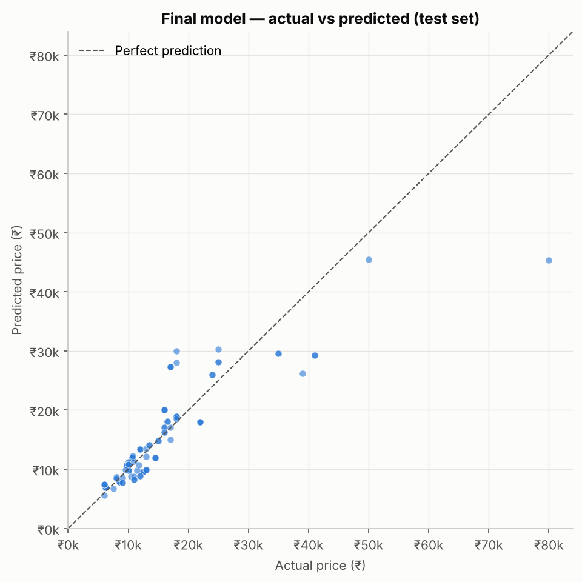

# Feature Extraction and Price Prediction for Mobile Phones

**NextHikes Data Science Internship — Project 4**

A mobile-phone retailer wants to understand **which specifications drive smartphone prices** and needs a model that
**estimates a phone's price from its specifications**. This repository covers the full workflow: data
investigation, cleaning, feature engineering, feature extraction and selection, model development with grouped
validation, explainability, and business recommendations.

## Results at a glance

| | |
|---|---|
| **Final model** | Average of Ridge regression + tuned Gradient Boosting, trained on log(price) |
| **Test MAE** (35 unseen phone models) | **₹2,796** (dummy baseline ₹6,163) |
| **Test R² / MAPE** | 0.75 / 15.6 % |
| **Within ±20 % of actual** | 73 % of unseen phones (90 % below ₹10k) |
| **Top price drivers** | processor tier, brand, RAM, front camera, battery (negative), storage |



**Key findings** (associations, not causal effects)
- **Processor tier** is the strongest driver: mainstream → flagship chip ≈ **+49 %** in the model.
- **RAM** 4 → 8 GB ≈ +21 %; each **storage** doubling ≈ +11–12 %. Storage is highly correlated with price but
  largely redundant once RAM and processor are known.
- **Bigger batteries go with cheaper phones** (6,000 vs 5,000 mAh ≈ −10 %): battery size marks budget positioning.
- **Rear-camera megapixels add no predictive value**: 12 MP iPhones/Pixels sit above 50–200 MP budget phones.
- **Random train/test splits are misleading here**: a decision tree looked 4× better under a random split than on
  genuinely unseen phone models. All results use splits **grouped by phone model**.

Full summary: [`reports/findings.md`](reports/findings.md) · Full report:
[`reports/project_report.pdf`](reports/project_report.pdf)

## Repository structure
```
mobile-price-prediction/
├── data/
│   ├── raw/Processed_Flipdata.csv          original data (never modified)
│   └── processed/                          clean data, split, excluded rows, cleaning log
├── notebooks/                              executed notebooks, one per project day
│   ├── 01_data_exploration.ipynb           structure, data dictionary, data-quality investigation
│   ├── 02_exploratory_data_analysis.ipynb  univariate / bivariate / multivariate EDA
│   ├── 03_data_preprocessing.ipynb         evidence-based cleaning
│   ├── 04_feature_engineering.ipynb        brand, processor tier/vendor, 5G flags; encoding comparison; split
│   ├── 05_feature_extraction.ipynb         correlation, MI, variance threshold, F-test, SelectKBest, RFE, PCA
│   ├── 06_feature_importance.ipynb         preliminary RF importance (impurity, permutation, Shapley)
│   ├── 07_baseline_model_training.ipynb    Dummy, Linear, Tree, Forest; grouped vs random CV
│   ├── 08_advanced_model_training.ipynb    GridSearch / RandomizedSearch, boosting, ensemble
│   ├── 09_model_evaluation.ipynb           hold-out test, residuals, bootstrap CI, learning curve
│   ├── 10_final_feature_analysis.ipynb     permutation, exact Shapley, what-if curves, interactions
│   └── 11_business_insights.ipynb          business charts and recommendations
├── src/
│   ├── data_loader.py        load + schema validation
│   ├── preprocessing.py      cleaning rules (clean_dataset)
│   ├── feature_engineering.py SpecFeatureBuilder + preprocessing pipeline
│   ├── feature_selection.py  correlation, mutual information, VIF helpers
│   ├── train.py              split, model definitions, training script
│   ├── evaluate.py           metrics, CV/hold-out comparison, diagnostic plots
│   ├── explain.py            exact Shapley values (no extra dependency)
│   ├── predict.py            validated inference API
│   └── plot_style.py         shared chart style
├── models/                   final_model.joblib + model_metadata.json
├── app/streamlit_app.py      optional price-estimator app
├── reports/                  findings, report (PDF + Markdown), data dictionary, logs, figures/
├── tests/                    pytest suite (40 tests)
├── requirements.txt
└── LICENSE
```

## Setup and reproduction
Requires Python 3.10+.
```bash
git clone <your-repo-url>
cd mobile-price-prediction
python -m venv .venv
# Windows: .venv\Scripts\activate     macOS/Linux: source .venv/bin/activate
pip install -r requirements.txt

python -m pytest                  # 40 tests
python -m src.train               # rebuild models/final_model.joblib from the raw CSV
jupyter notebook                  # open notebooks/ and run them in order (01 → 11)
```
`python -m src.train` runs the whole pipeline (load → clean → grouped split → fit → evaluate → refit on all data →
save) and prints the hold-out metrics (MAE ₹2,796, R² 0.752). Notebook 08 runs the hyperparameter searches (~3 min).

### Predicting a price in code
```python
from src.predict import predict_price
predict_price({"model": "Samsung Galaxy M34 5G", "processor": "Exynos 1280", "storage_gb": 128,
               "ram_gb": 6, "battery_mah": 6000, "rear_camera_mp": 50, "front_camera_mp": 13,
               "ai_lens": 0, "display_size_cm": 16.51})
# {'predicted_price': ..., 'warnings': []}
```

### Optional: Streamlit app
```bash
pip install streamlit
streamlit run app/streamlit_app.py
```
The app loads the saved pipeline through `src/predict.py`, validates inputs, warns when a spec is outside the
training range, and states that the estimate is not a guaranteed market price.

## Dataset
`Processed_Flipdata.csv` (NextHikes): 541 Flipkart India listings × 12 columns — model, colour, storage (GB),
RAM (GB), battery (mAh), rear/front camera (MP), AI-lens flag, display size (cm; the column is named
"Mobile Height"), processor, price (INR; the column is spelled "Prize"). See
[`reports/data_dictionary.md`](reports/data_dictionary.md).

## Method
1. **Data quality** (`01`, `03`): found and documented 20 issues; e.g. feature-phone rows inheriting storage/RAM
   from the previous listing, suspected truncation of 12 GB RAM, a 41.94 cm display entry, a mislabelled model.
   Every fix is justified with evidence and logged in [`reports/data_cleaning_log.md`](reports/data_cleaning_log.md).
2. **EDA** (`02`): log price; strongest associations with processor tier, storage, front camera, RAM; battery negative.
3. **Feature engineering** (`04`): brand, processor vendor and ordinal tier (from 123 messy chipset strings), 5G and
   Pro/Plus flags from model names. Model name and colour were tested and rejected as features (they don't generalise).
4. **Feature extraction / selection** (`05`, `06`): eight techniques compared. All features kept; PCA rejected.
5. **Modelling** (`07`–`09`): grouped 5-fold CV for selection, untouched grouped test set for final evaluation,
   all preprocessing inside scikit-learn pipelines (no leakage).
6. **Explainability** (`10`): permutation importance, exact Shapley values for every test phone, what-if curves,
   interaction checks, individual explanations.

## Limitations
- Small dataset (516 rows, 172 models); thin premium coverage → **premium phones under-predicted**.
- RAM capped at 8 GB in the source; 15 values missing → RAM effect understated.
- No launch date, so older flagships are over-predicted. Single snapshot with no listing dates.
- Feature phones are out of scope.
- Importance and effects are associations in observational data, not causal effects.

## Optional dependency note
`shap` is optional. Notebooks 06 and 10 compute exact Shapley values with `src/explain.py`, and use `shap` as a
cross-check if it's installed.
