# Feature Extraction and Price Prediction for Mobile Phones

**Project report — NextHikes Data Science Internship, Project 4**

Author: Bhav · Date: November 2026 · Code: this repository (notebooks 01–11, `src/`)

<!-- pagebreak -->

## 1. Abstract

A mobile-phone retailer wants to know which specifications drive smartphone prices and to estimate a phone's price
from its specifications. Using 541 Flipkart India listings, we investigated data quality in detail (20 documented
issues, including scraper-copied values and truncated RAM), cleaned the data to 516 smartphone listings of 172
models, engineered interpretable features from free text (processor tier and vendor, brand, 5G and premium-variant
flags), and compared eight feature extraction/selection techniques. Models were evaluated with validation **grouped
by phone model**, so every score measures performance on phones the model has never seen; a random split would have
overstated accuracy by up to four times. The selected model, an equal-weight average of Ridge regression and tuned
Gradient Boosting on log price, achieves a hold-out test MAE of ₹2,796 (R² 0.75, MAPE 15.6 %) against ₹6,163 for a
naive baseline, and is most reliable below ₹20k. Processor tier is the strongest price driver (mainstream → flagship
chip ≈ +49 %), followed by brand, RAM (4 → 8 GB ≈ +21 %), front camera, battery (negative: large batteries mark
budget phones) and storage. Rear-camera megapixels carry no predictive value. We recommend using the model for
preliminary estimates in the budget and mainstream segments, with human review for premium phones.

## 2. Introduction

Smartphone pricing in India is highly competitive: hundreds of models from more than a dozen brands compete in narrow
price bands, often differing only in memory configuration or colour. A retailer that understands how specifications
translate into price can position its listings more consistently, spot over- or under-priced stock, and estimate a
reasonable price for new arrivals before market data accumulates.

This report documents a complete, reproducible machine-learning project addressing that need, from raw data to a
saved, tested prediction pipeline and an optional interactive application. Every number reported here was produced
by the executed notebooks in the repository.

## 3. Problem Statement

Given a smartphone's specifications (brand/model name, processor, storage, RAM, battery, cameras, display size and
an AI-lens flag), **estimate its selling price**, and **identify which specifications are most strongly associated
with price**. The model must generalise to phone models that are not in the training data, and its behaviour must be
explainable to a non-technical pricing team.

## 4. Project Objectives

- **Objective A — Price prediction:** a supervised regression model that estimates price from specifications, with
  honestly measured accuracy on unseen phone models.
- **Objective B — Feature extraction and analysis:** identify, rank and interpret the specifications most related to
  price, using statistical, model-based and explanation-based methods.
- Deliver reproducible code, a saved model, documentation and business recommendations.

## 5. Business Scenario

The client is an organisation that sells mobile phones. It wants to improve its pricing strategy by understanding
which features influence prices in the current market, and to use a model for preliminary price estimation. The
outputs must support two teams: **pricing** (setting and checking prices) and **marketing** (deciding which features to
emphasise). Wrong estimates have a cost in both directions (lost margin or unsold stock), so the model's limits matter
as much as its average accuracy.

## 6. Dataset Description

`Processed_Flipdata.csv`, supplied with the assignment, contains **541 rows × 12 columns** of Flipkart India listings.
Each row is a *listing variant*: one model in one colour and one storage/RAM configuration. The 541 rows describe only
187 model names (≈ 181 after case normalisation), 275 colours and 123 distinct processor strings. The target column is
spelled `Prize` and stored as a comma-formatted string (e.g. "7,299"); prices range from ₹920 to ₹80,999 with a strong
right skew (skewness 2.43). There are no explicit missing values, but several forms of disguised missingness and
error (Section 10).

## 7. Data Dictionary

| Raw column | Meaning | Unit | Notes | Treatment |
|---|---|---|---|---|
| Unnamed: 0 | Leftover index (0–642, 102 gaps) | — | not a feature | dropped |
| Model | Brand + model name | — | 187 values; case variants | brand, 5G, Pro flags; grouping key |
| Colour | Marketing colour | — | 275 values; garbled "M3)" | not used |
| Memory | Internal storage | GB | 16–256 | numeric |
| RAM | RAM | GB | 2–8 only; suspected truncation | numeric; 15 set to missing |
| Battery_ | Battery capacity | mAh | 800–7,000 | numeric |
| Rear Camera | Primary rear camera | MP | "50MP" text | parsed to number |
| Front Camera | Front camera | MP | "0MP" = none | parsed to number |
| AI Lens | AI-lens flag | 0/1 | Infinix only | binary |
| Mobile Height | Display diagonal (despite the name) | cm | 41.94 error | numeric; corrected |
| Processor_ | Chipset text | — | 123 spellings | vendor + ordinal tier |
| Prize | Selling price (target) | INR | comma string | integer; log for modelling |

## 8. Exploratory Data Analysis

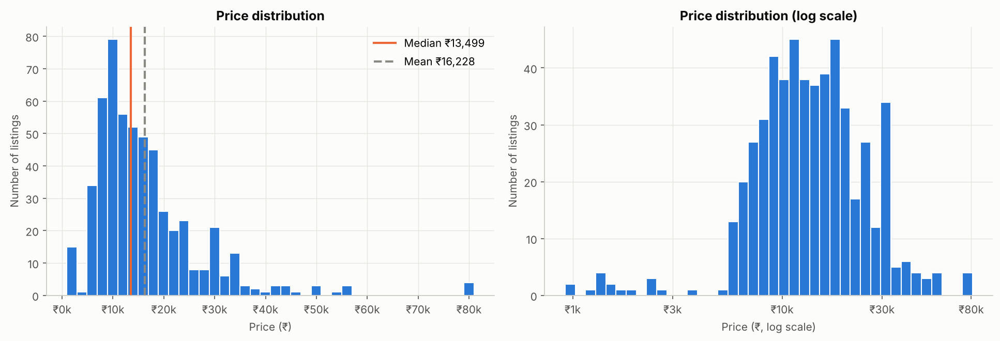

Price is heavily right-skewed: 77 % of listings are under ₹20k, with a tail of premium phones up to ₹81k. On a log
scale the distribution is close to symmetric, which motivated modelling log(price).

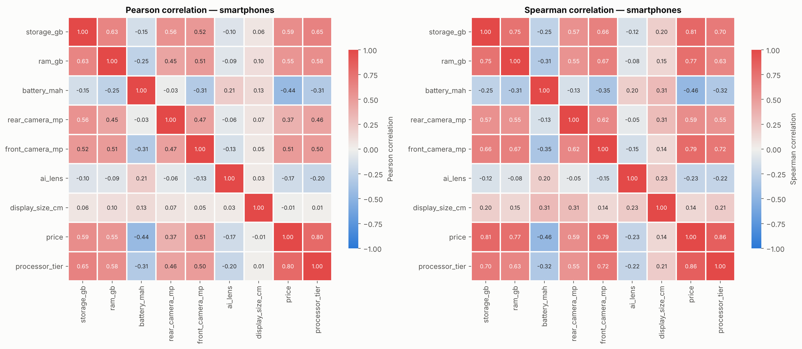

Among smartphones, the strongest monotonic (Spearman) associations with price are processor tier (0.86), storage
(0.81), front camera (0.79) and RAM (0.77); rear camera is moderate (0.59). Two associations are counter-intuitive:
**battery is negative (−0.46)** and the **AI-lens flag is negative (−0.23)**. Both reflect market segment and brand
rather than value. Budget phones advertise 6,000 mAh batteries, and the AI-lens flag appears only on Infinix, a
budget brand. Rear-camera megapixels are a poor quality signal: 12 MP phones (iPhones, Pixels) have one of the highest
median prices. Storage, RAM, front camera and processor tier are inter-correlated (0.6–0.75) because manufacturers
upgrade them together.

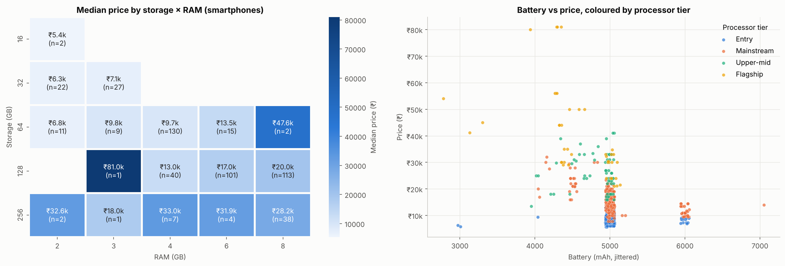

Colouring battery against price by processor tier shows the negative battery correlation is a segment effect:
flagship and upper-mid phones cluster at 4,000–4,800 mAh, entry phones at 5,000–6,000 mAh.

## 9. Data Cleaning and Preprocessing

All rules are implemented in `src/preprocessing.py` and justified with evidence in notebooks 01 and 03. Each anomaly
was classified as a formatting problem, data-entry error, genuine extreme, or unusual-but-valid value. Only errors
were corrected.

| Step | Classification | Rows |
|---|---|---|
| Drop index; rename columns (e.g. Prize → price, Mobile Height → display_size_cm) | artefact | all |
| Parse price and camera strings to integers (parsers fail loudly) | formatting | all |
| Whitespace, encoding repair, 3 model-name typos, colour case | formatting / entry | 28 |
| Relabel a "Google Pixel 6a" row whose 7 spec fields equal Nothing Phone 1 | labelling error | 1 |
| Display 41.94 cm → 16.64 cm (same model's other rows) | entry error | 2 |
| Remove duplicate listings | duplicate | 10 |
| Exclude feature phones (battery < 2,600 mAh or display < 10 cm) | scope / unreliable values | 15 |
| RAM → missing for 256 GB phones with ≤ 4 GB and for Apple rows | scraping error | 15 |

Two findings deserve emphasis. First, **feature-phone rows inherit colour, storage and RAM from the listing above
them**: in all 16 such rows the colour equals the previous row's, so a ₹1,299 phone is recorded with 256 GB / 8 GB.
These rows were excluded and the model's scope limited to smartphones. Second, **RAM never exceeds 8 GB**, and
premium 256 GB variants are recorded with 2–4 GB at *higher* prices than their own 8 GB variants, consistent with
"12 GB" losing a digit. These values were set to missing rather than replaced with outside data, and are imputed
from the training median inside the pipeline. Neither rule uses price.

Outliers were not removed automatically. The 25 premium prices above the IQR fence are genuine. The IQR rule flags
152 battery values only because 72 % of phones have exactly 5,000 mAh.

Result: **516 smartphone listings of 172 models**.

## 10. Feature Engineering

| Feature | Derived from | Encoding | Rationale |
|---|---|---|---|
| processor_tier (0–3) | processor text | ordinal | chip family positioning: entry, mainstream, upper-mid, flagship |
| processor_vendor | processor text | one-hot | Qualcomm, MediaTek, Exynos, Unisoc, Tensor, Apple, Unknown |
| brand | model name | one-hot, rare (< 5) pooled | strong price bands; unseen brands handled |
| is_5g, is_premium_variant | model name | binary | 5G listings median ₹19.7k vs ₹10k |
| storage, RAM, battery, cameras, display, AI lens | numeric columns | median-imputed (scaled for linear models) | — |

Tier is based on the chip family's public positioning (e.g. Snapdragon 8-series = flagship), not on prices in the
data, so it is not a disguised target encoding. Five processor strings that name no chip ("Oxygen OS", "Octa Core")
receive a missing tier, imputed in the pipeline.

Encoding choices were tested with grouped cross-validation (Ridge, log price). Adding brand/vendor one-hot to numeric
specs cut CV MAE from ₹3,126 to ₹2,408. Frequency encoding was worse (₹2,975). One-hot encoding the full model name
(₹2,500) or colour (₹2,481) made generalisation worse, so neither is used. All variance inflation factors are below three.
The **preprocessing pipeline** (`SpecFeatureBuilder` → `ColumnTransformer`) is fitted only on training folds and
handles unseen brands, unknown chips and missing values safely.

The data was split **before** any feature analysis with `GroupShuffleSplit` by model: 419 training rows (137 models)
and 97 test rows (35 models), with no model in both.

## 11. Feature Extraction Techniques

Feature extraction *creates* new representations; feature selection *keeps a subset* of existing features. The
project uses both.

- **Text-based extraction** (Section 10): processor tier/vendor and model-name flags. Processor tier became the single
  strongest feature (Spearman 0.86).
- **Principal Component Analysis:** on standardised training features, PC1 ("premium-ness": storage, RAM, tier,
  front camera and 5G positive; battery negative) explains 14.9 % of variance; 17 components are needed for 90 % and
  20 for 95 % of 29. Ridge on 17 components reached CV MAE ₹2,350 vs ₹2,408 for untuned Ridge on all features, a
  regularisation effect within fold noise (₹700) that tuned Ridge matches without PCA (₹2,331). **PCA was not adopted**
  because it gives no reliable gain and removes interpretability.

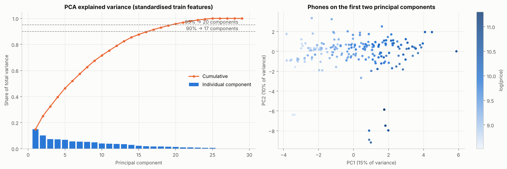

## 12. Feature Selection

Six selection techniques were applied on the training set, with any CV-evaluated selector placed inside the pipeline.

| Technique | Key result |
|---|---|
| Pearson / Spearman | Against log price both agree; top: tier, storage, RAM, front camera, 5G |
| Mutual information | Same core; display size scores high (0.62) despite low correlation, a fingerprint of phone families |
| Variance threshold (0.01) | removes nothing; rarest column brand_Apple (0.0118) is rare but important |
| F-test / SelectKBest | 22 of 29 features significant; Ridge best with all; untuned GB best with 8 MI-selected (₹2,583 vs ₹2,810) |
| RFE / RFECV | RF-RFE keeps RAM, front camera, tier, storage, battery longest; RFECV (Ridge) keeps 22 |

The consensus ranking across methods is processor tier, RAM, storage, front camera, then rear camera, 5G and battery.
Selection helped only the untuned boosting model. After tuning, all features performed best for every model
(Section 15), so **all 29 encoded features are used**.

## 13. Machine Learning Methodology

- **Target:** log(1 + price), back-transformed to rupees for all reported metrics.
- **Validation:** grouped 5-fold cross-validation on the training set for model selection and tuning; a single
  evaluation on the grouped hold-out test set at the end. All learned preprocessing lives inside scikit-learn
  pipelines, so nothing is fitted on validation or test data.
- **Metrics:** MAE (typical rupee error), RMSE (penalises large misses), R², and MAPE.

**Why grouped validation matters.** With a random split, colour variants of the same phone appear in both training and
validation. A decision tree then "recognises" the phone. Its CV MAE was ₹847 under a random split but ₹3,470 under
grouped CV, and model rankings reversed.

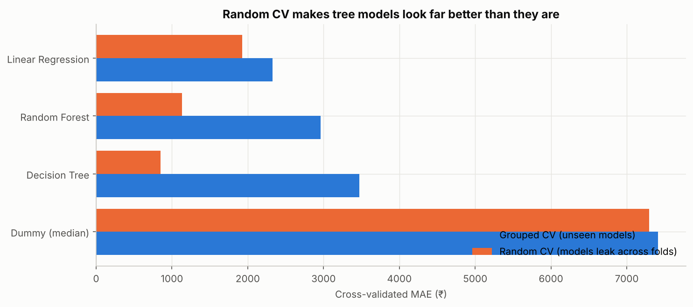

## 14. Model Development

| Baseline (grouped 5-fold CV, log target) | Train MAE | CV MAE | CV R² |
|---|---|---|---|
| Dummy (median) | ₹7,239 | ₹7,411 | −0.12 |
| Linear Regression | ₹1,750 | ₹2,330 | 0.85 |
| Decision Tree | ₹124 | ₹3,470 | 0.67 |
| Random Forest | ₹445 | ₹2,959 | 0.70 |

Linear regression on log price was the best baseline. Trees overfit, with near-perfect training fits that don't
transfer to new models. The log target improved linear regression substantially (₹2,738 → ₹2,330) because
specification effects are multiplicative, but slightly hurt untuned trees.

## 15. Hyperparameter Optimisation

GridSearchCV was used for Ridge (28 combinations) and RandomizedSearchCV for the tree ensembles (30–40 draws each),
all scoring MAE under grouped 5-fold CV. Budgets were kept modest to avoid fitting fold noise.

| Model | Best parameters | Best CV MAE |
|---|---|---|
| Ridge | alpha 0.01, brand min_frequency 5 | ₹2,331 |
| Random Forest | depth 8, max_features 0.3, min_samples_leaf 2 | ₹2,807 |
| Gradient Boosting | 127 trees, learning rate 0.16, depth 3, min_samples_leaf 9 | ₹2,427 |
| HistGradientBoosting | 388 iterations, learning rate 0.084, depth 4, leaf 9, L2 0.006 | ₹2,469 |

Tuning moved every tree model towards regularisation (shallower trees, larger leaves). No single tuned model beat
Ridge, but an **equal-weight average of Ridge and tuned Gradient Boosting** reached CV MAE ₹2,171 with the lowest
fold variability. The two models make different errors: Ridge is smooth and extrapolates, while boosting captures
thresholds. Weights were fixed at 0.5 rather than tuned. Re-testing feature selection for the tuned models confirmed
all features are best (GB ₹2,469 vs ₹2,525–2,533 with 8–10 MI features), and the log target beat raw price for tuned
GB (₹2,469 vs ₹2,606).

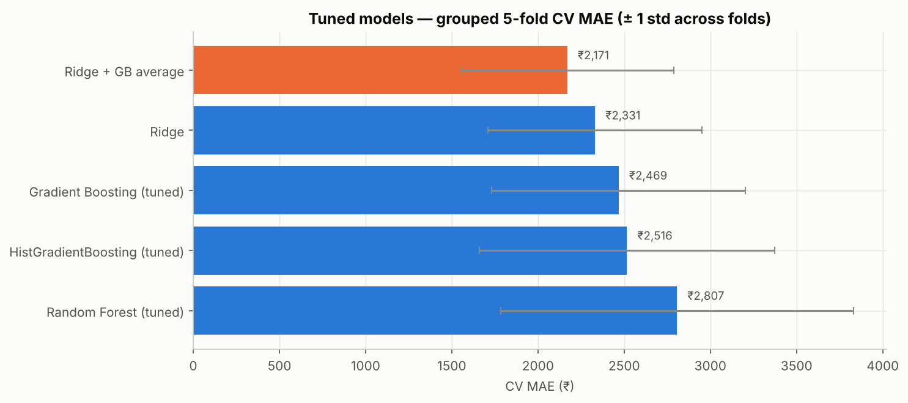

## 16. Model Evaluation

| Model | Train MAE | CV MAE | Test MAE | Test RMSE | Test R² | Test MAPE |
|---|---|---|---|---|---|---|
| Dummy (median) | ₹7,261 | ₹7,411 | ₹6,163 | ₹10,469 | −0.01 | 42.3 % |
| Linear Regression | ₹1,804 | ₹2,330 | ₹2,936 | ₹5,785 | 0.69 | 16.7 % |
| Ridge | ₹1,805 | ₹2,331 | ₹2,935 | ₹5,783 | 0.69 | 16.7 % |
| Random Forest (tuned) | ₹1,183 | ₹2,807 | ₹3,178 | ₹6,192 | 0.65 | 16.5 % |
| Gradient Boosting (tuned) | ₹862 | ₹2,469 | ₹2,969 | ₹5,349 | 0.74 | 15.8 % |
| HistGradientBoosting (tuned) | ₹505 | ₹2,516 | ₹2,878 | ₹5,158 | 0.76 | 15.6 % |
| **Ridge + GB average** | ₹1,217 | **₹2,171** | **₹2,796** | ₹5,190 | 0.75 | 15.6 % |

The average has the best CV MAE and the best test MAE. HistGradientBoosting ties it on test R²/RMSE but was fourth in
CV and overfits most (test MAE 5.7× its training MAE). On a group bootstrap over the 35 test models, the final
model's test MAE has a 95 % interval of ₹1.7k–₹4.2k, and it beats Ridge in 74 % of resamples (difference interval
−₹625 to +₹259). The test set alone can't separate the two; CV and test together favour the average.

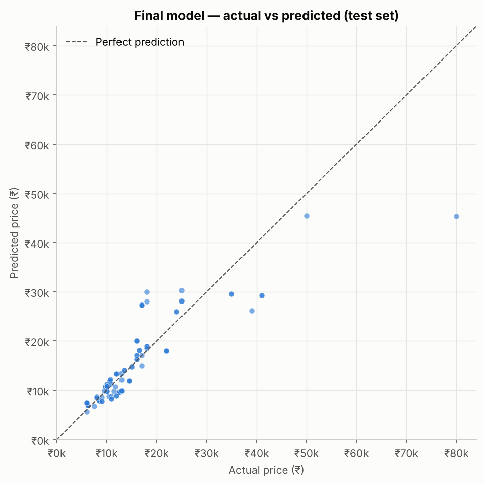

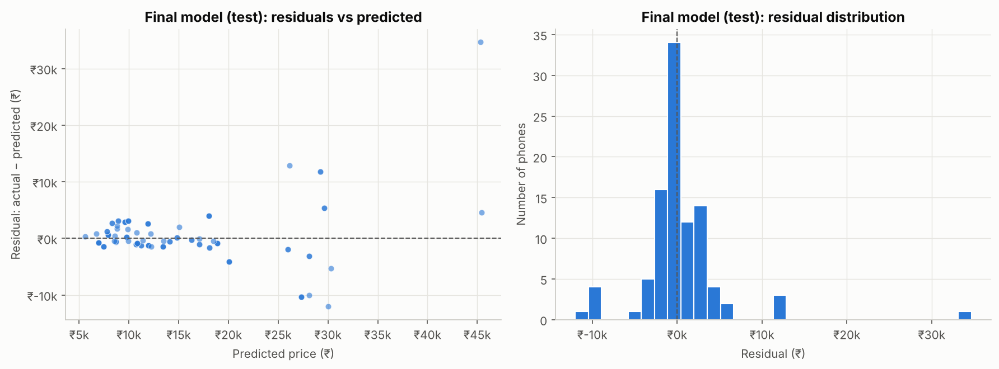

64 % of unseen phones are within ±₹2,000 and 73 % within ±20 %. Residuals are centred near zero but widen with price,
as expected for a log-target model. Accuracy by price band: MAE ₹797 below ₹10k (90 % within ±20 %), ₹1,815 at
₹10–15k, while phones above ₹30k are always under-predicted (MAE ₹12,351). The largest errors fall into two groups:
**older flagship chips sold at clearance prices** (realme X3 SuperZoom, Galaxy F23 5G, over-predicted by ~₹10k
because the data has no launch date), and **premium Samsung phones** (Galaxy S23 predicted ₹45k vs ₹80k; A54).

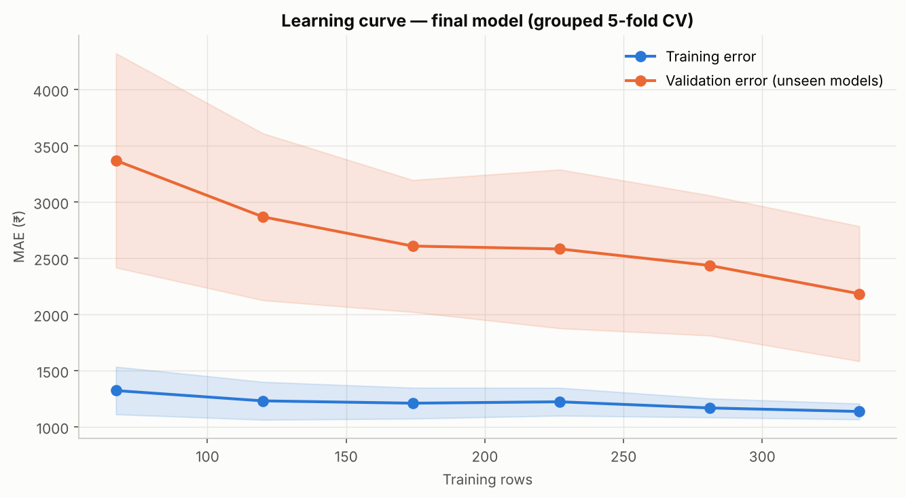

The learning curve shows validation error still falling as training data grows (₹3,370 → ₹2,184), so the model is
data-limited: more listings, especially premium ones, would improve it.

**Selected model:** Ridge + Gradient Boosting average on log price. The deployed model has the same pipeline and
parameters, refit on all 516 rows (`python -m src.train`).

## 17. Feature Importance and Explainability

All importance measures were computed for the final model fitted on the training set and evaluated on the 97
unseen test phones.

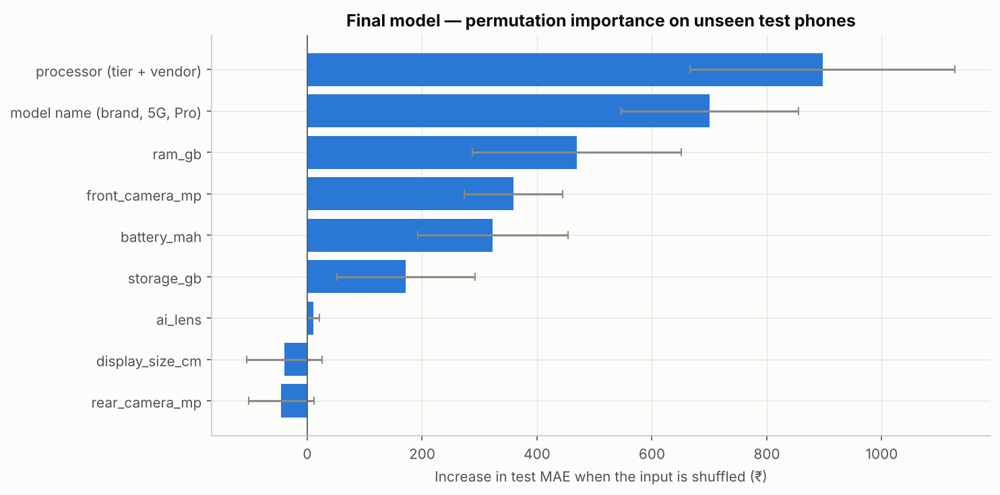

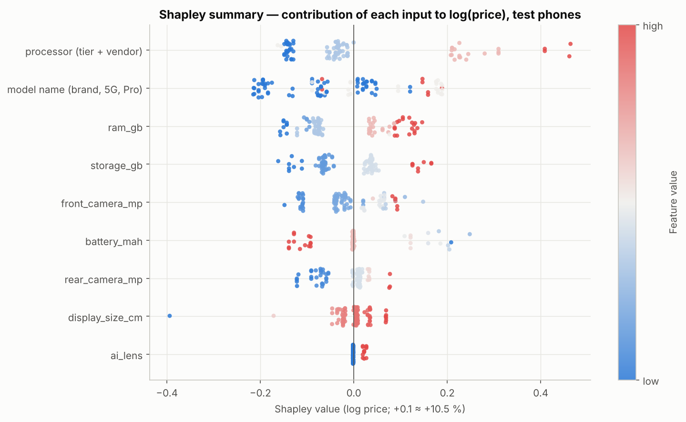

| Input | Permutation (+MAE ₹) | Mean abs. Shapley (≈ % effect) | Day 5 Spearman |
|---|---|---|---|
| Processor (tier + vendor) | 897 | 12.4 % | 0.86 |
| Model name (brand, 5G, Pro) | 701 | 11.6 % | 0.60 |
| RAM | 469 | 9.1 % | 0.80 |
| Front camera | 359 | 5.9 % | 0.79 |
| Battery | 323 | 4.0 % | −0.46 |
| Storage | 172 | 6.5 % | 0.81 |
| AI lens / display / rear camera | ≈ 0 or negative | ≤ 3.4 % | — |

Shapley values were computed **exactly** (all 512 coalitions of the 9 inputs, interventional, 60-row background) with
`src/explain.py`; their sum equals each prediction, which was verified. Permutation importance and Shapley values agree
on the top three. Storage is the clearest case of **correlation ≠ predictive importance**: second by correlation but
sixth by permutation, because its information overlaps with RAM and processor. Rear camera is moderately correlated
(0.59) yet has negative permutation importance.

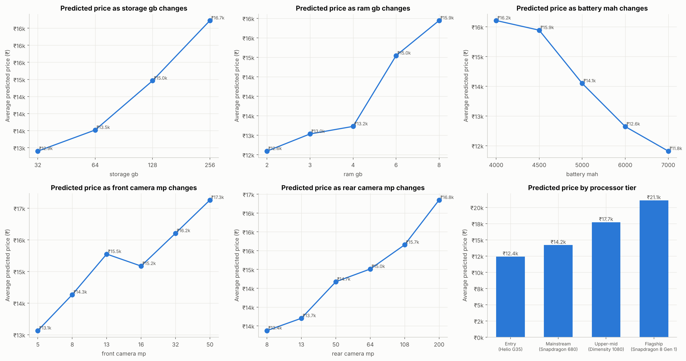

Partial-dependence ("what-if") effects, other specs fixed: mainstream → flagship processor +48.5 %, entry → mainstream
+14.3 %, RAM 4 → 8 GB +20.5 %, storage 64 → 128 GB +10.7 % and 128 → 256 GB +11.8 %, front camera 8 → 16 MP +6.3 %,
battery 5,000 → 6,000 mAh −10.3 %. **Interactions are weak**: processor tier × storage deviates from an additive-in-log
pattern by at most ±1.6 %, and the battery effect is the same in every tier. Effects are approximately multiplicative.

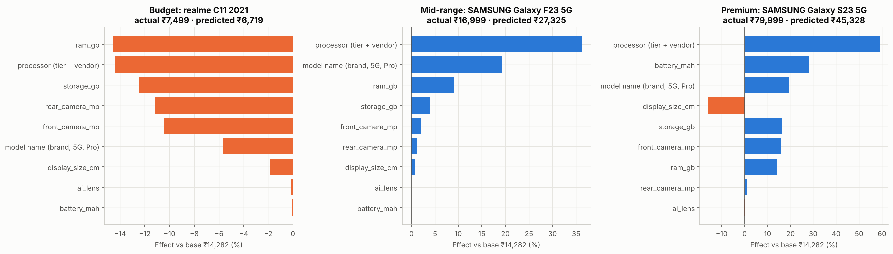

Individual explanations show why each estimate came out as it did. For example, the Galaxy F23 5G's upper-mid chip
contributes +36 %, which explains its over-prediction. These are associations learned from observational data and do
not show causal effects.

## 18. Results and Discussion

The project answers both objectives. For **prediction**, the model explains about three quarters of price variation
on unseen phone models and cuts the naive error by 55 % on the test set (71 % in CV). It is accurate for budget and
mainstream phones, where most listings are, and weak for premium phones. For **feature analysis**, statistical,
model-based and Shapley methods converge on processor tier, brand, RAM, front camera and storage, and on the negative
role of battery.

Two methodological results matter beyond this dataset. First, **grouped validation changed the conclusions**: a random
split would have selected an overfitted decision tree and reported accuracy four times better than reality. Second,
**data investigation drove model quality**: excluding copied feature-phone values and blanking implausible RAM made
the storage/RAM relationships cleaner, and the strongest feature (processor tier) came from parsing messy text, not
from model tuning.

## 19. Business Recommendations

1. **Set the price band by processor tier, then adjust for RAM/storage variants and brand.** Tier is the largest
   effect; memory moves price within the band; brand positioning shifts the whole band.
2. **Do not justify premiums with rear-camera megapixels or battery size.** Market large batteries as budget value.
3. **Lead marketing with processor and memory** in mid/premium listings, and with 5G and front camera in the
   ₹10–20k segment, where they distinguish similar phones.
4. **Use the model for preliminary estimates below about ₹20k.** Require human review above ₹25k, for older
   flagships, unfamiliar brands and specs outside the training range (the app warns automatically).
5. **Improve the data:** add launch date, true RAM (12 GB+), display/charging specs and more premium listings;
   retrain quarterly as chip generations change.

## 20. Limitations

- Small sample (516 listings, 172 models) and only 35 test models, so metrics have wide uncertainty (₹1.7k–4.2k).
- Thin premium coverage (Apple 5, Google 8 listings) → systematic under-prediction above ₹30k.
- RAM capped at 8 GB and missing for 15 premium rows → RAM effect understated.
- No launch date or listing date → older flagships over-predicted; single snapshot, prices drift.
- Processor tier relies on a hand-written mapping of chip families that needs maintenance for new chips.
- Feature phones excluded; results do not apply to them.
- All importance and effect estimates are associations in observational data, not causal effects.

## 21. Future Scope

- Collect launch dates, refresh rate, charging power, build materials, and listing dates for time-aware validation.
- Gather more premium phones; consider a separate premium-segment model or quantile regression for price ranges.
- Replace the hand-written chip tiers with benchmark scores (e.g. CPU/GPU benchmark results).
- Monitor prediction error after deployment and retrain on a schedule.
- Prediction intervals (e.g. conformal prediction) to give a range instead of a point estimate.

## 22. Conclusion

A careful, leakage-free workflow produced a compact, explainable pricing model: a Ridge + Gradient Boosting average
on log price, with a test MAE of ₹2,796 and R² of 0.75 on phone models it had never seen. Processor tier, brand and
memory dominate price, battery size marks budget positioning, and camera megapixels say little. The model is ready
for preliminary price estimation in the budget and mainstream segments, and its documented limits show where human
judgement and better data are still needed.

## 23. Reproducibility

`pip install -r requirements.txt`, then `python -m pytest` (40 tests) and `python -m src.train`, which rebuilds the
model from the raw CSV and prints the hold-out metrics. Notebooks 01–11 are saved with outputs and can be re-run in
order. Random seed 42 throughout.

## 24. References

1. Pedregosa, F. et al. (2011). Scikit-learn: Machine Learning in Python. *Journal of Machine Learning Research*, 12, 2825–2830.
2. Breiman, L. (2001). Random Forests. *Machine Learning*, 45(1), 5–32.
3. Friedman, J. H. (2001). Greedy Function Approximation: A Gradient Boosting Machine. *Annals of Statistics*, 29(5), 1189–1232.
4. Hoerl, A. E. & Kennard, R. W. (1970). Ridge Regression: Biased Estimation for Nonorthogonal Problems. *Technometrics*, 12(1), 55–67.
5. Jolliffe, I. T. (2002). *Principal Component Analysis* (2nd ed.). Springer.
6. Kraskov, A., Stögbauer, H. & Grassberger, P. (2004). Estimating Mutual Information. *Physical Review E*, 69, 066138.
7. Guyon, I., Weston, J., Barnhill, S. & Vapnik, V. (2002). Gene Selection for Cancer Classification using Support Vector Machines (RFE). *Machine Learning*, 46, 389–422.
8. Shapley, L. S. (1953). A Value for n-Person Games. In *Contributions to the Theory of Games II*, 307–317.
9. Lundberg, S. M. & Lee, S.-I. (2017). A Unified Approach to Interpreting Model Predictions. *NeurIPS 30*.
10. Molnar, C. (2022). *Interpretable Machine Learning* (2nd ed.). christophm.github.io/interpretable-ml-book.
11. NextHikes (2026). Project 4 brief: Feature Extraction and Price Prediction for Mobile Phones; dataset `Processed_Flipdata.csv`.
